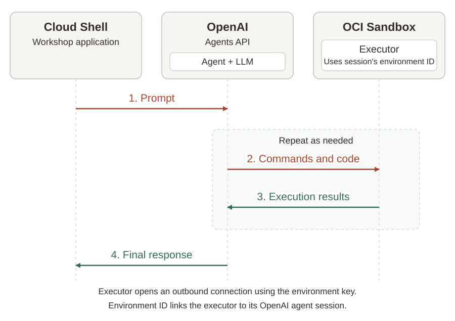
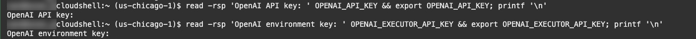
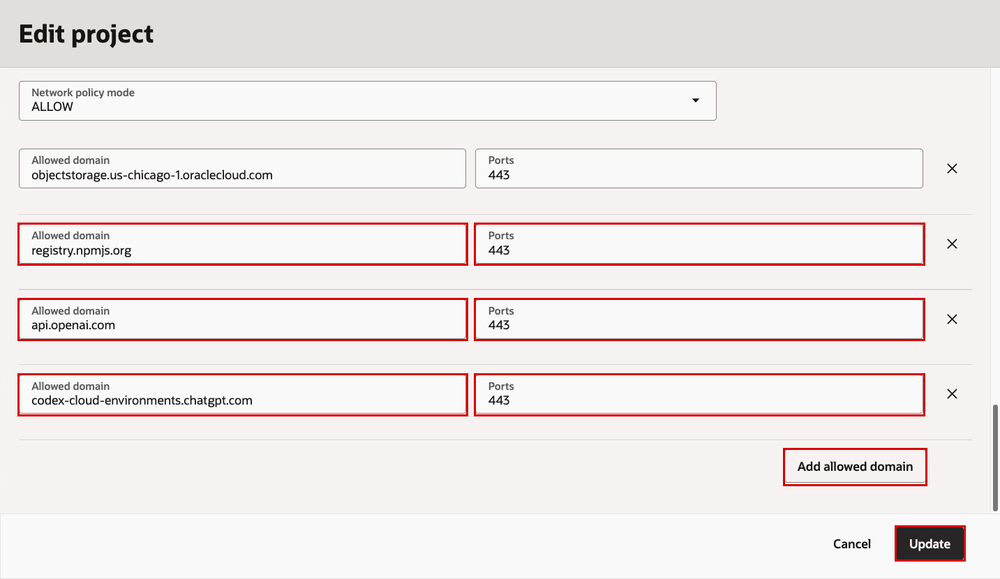
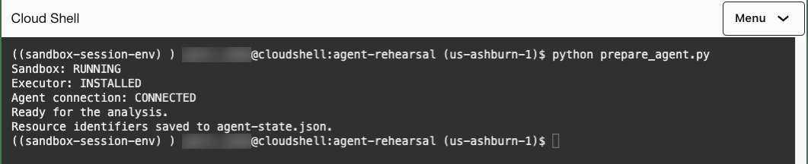
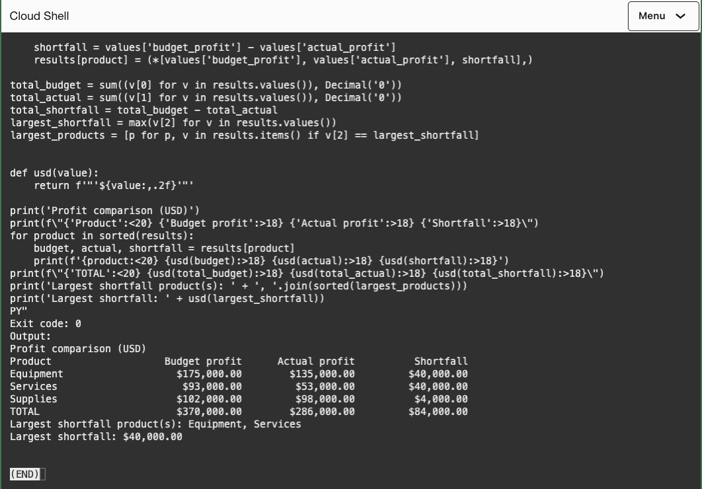
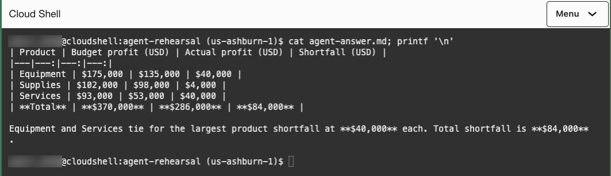

# Connect an OpenAI agent to an OCI Sandbox

## Introduction

In this lab, you will connect an OpenAI agent to an OCI Sandbox and ask it to compare budgeted and actual profit using the sample financial data from Lab 2. The agent will generate code, execute it in the sandbox and use the results to answer your request. You will inspect its commands, execution output and final response to understand how an agent uses a sandbox to complete a task.

<style>
#module-content img[src$="agent-information-flow.svg"] { width: 900px; max-width: 100%; }
</style>



### Objectives

* Connect an OpenAI agent to an OCI Sandbox for code execution.
* Use the agent to analyze the sample financial data.
* Inspect the agent's commands and execution results to understand how they contribute to its final response.

Estimated Time: 25 minutes.

### Prerequisites

* Complete **Lab 1: Setup**.
* **OpenAI API key:** Follow the [API key creation instructions](https://developers.openai.com/api/docs/quickstart#create-and-export-an-api-key).
* **Environment key:** Follow the [environment key creation instructions](https://developers.openai.com/api/docs/guides/agents-api/environments/self-hosted#authentication). Use the same organization, project and user or service account as the OpenAI API key.

> **Note:** Use dedicated keys for this workshop and revoke both keys when finished.

## Task 1: Configure OpenAI credentials

1. If you reopened Cloud Shell, return to the workshop folder and activate the Python environment:

    ```bash
    <copy>
    cd ~/sandboxes-workshop && source .venv/bin/activate
    </copy>
    ```

2. In Cloud Shell, run the following command. At the prompt, paste your **OpenAI API key** and press **Enter**. Your input is hidden. The application uses this key to manage the agent session and request model responses.

    ```bash
    <copy>
    read -rsp "OpenAI API key: " OPENAI_API_KEY && export OPENAI_API_KEY; printf '\n'
    </copy>
    ```

3. Run the following command, paste your **environment key** and press **Enter**. Your input is hidden. This key allows the sandbox to connect to OpenAI and receive the agent's commands.

    ```bash
    <copy>
    read -rsp "OpenAI environment key: " OPENAI_EXECUTOR_API_KEY && export OPENAI_EXECUTOR_API_KEY; printf '\n'
    </copy>
    ```

    

The keys are available to scripts run from this Cloud Shell session. If you restart Cloud Shell, repeat this task.

## Task 2: Connect the agent to an OCI Sandbox

To run the OpenAI agent's code in an OCI Sandbox, you will install a component called an **executor** inside the sandbox. It connects to OpenAI, receives the agent's commands, runs them in the sandbox, and sends the output back to the agent.

1. The executor needs outbound access to download its package, connect to OpenAI and exchange commands and results with the agent. Add the required domains to your project's network allowlist.

    In the OCI Console, return to **Generative AI → Projects** and select your workshop compartment. Click the project you created in Lab 1, then click **Actions → Edit**. Under **Sandbox configuration**, enter these settings:

    * **Network policy mode:** Select `ALLOW`.
    * **Allowed domain:** Add each hostname below, preserving any existing entries.
    * **Ports:** Enter `443` for each entry.

    | Allowed domain | Purpose |
    | --- | --- |
    | `registry.npmjs.org` | Download the executor package. |
    | `api.openai.com` | Register the executor with OpenAI. |
    | `codex-cloud-environments.chatgpt.com` | Exchange commands and results over a secure WebSocket connection. |

    

    Click **Update**.

2. In Cloud Shell, run the preparation script included in the workshop ZIP:

    ```bash
    <copy>
    python prepare_agent.py
    </copy>
    ```

    The script uses the project and region saved in Lab 1. It creates a **Small** Python sandbox with a 60-minute lifetime, uploads the packaged `monthly-financials.csv`, and installs the executor.

    It also creates an OpenAI agent session using [GPT-6 Luna](https://developers.openai.com/api/docs/models/gpt-6-luna). In [prepare_agent.py](../files/sandboxes-workshop/prepare_agent.py), this request configures the session to use an environment you provide:

    <!-- source: prepare_agent.py -->

    ```python
    return api.post(
        '/agents/sessions',
        cast_to=JSON,
        body={
            'agent': {
                'model': MODEL,
                'instructions': (
                    'Analyze the supplied CSV '
                    'using Python in /workspace. '
                    'Use actual execution results.'
                ),
            },
            'environment': {
                'type': 'self_hosted',
                'workspace_directory': '/workspace',
            },
        },
    )
    ```

    OpenAI returns an environment ID and connection URL. The script supplies these to the executor, along with the environment key from Task 1:

    <!-- source: prepare_agent.py -->

    ```python
    arguments = [
        'exec-server',
        '--remote', environment['remote_url'],
        '--environment-id', environment['id'],
    ]
    command = client.run_sandbox_command(
        state['sandbox_id'],
        RunSandboxCommandDetails(
            command=EXECUTOR,
            args=arguments,
            cwd='/workspace',
            timeout='PT60M',
            environment_variables=[
                EnvironmentVariable(
                    name='CODEX_API_KEY',
                    value=environment_key,
                ),
            ],
        ),
        opc_retry_token=retry_token(state, 'executor_token'),
    ).data
    ```

    The executor opens an outbound connection to OpenAI. The environment key authenticates it; the environment ID associates it with the agent session. The agent sends commands through this connection to the attached sandbox. The application API key stays in Cloud Shell.

3. Confirm that the sandbox is running, the executor is installed and the agent connection is connected:

    

    The script saves the sandbox, session and environment IDs in `agent-state.json` for the following tasks. Keep this file when retrying so the script can resume with the resources it already created.

    If installation fails, check the `registry.npmjs.org` rule. If the connection fails, check the other two hostnames and confirm that both keys have the matching ownership specified in the prerequisites. Follow the script's error message before retrying.

## Task 3: Run the financial analysis

With the agent connected, you can ask it to analyze the CSV uploaded in Task 2. The agent will write and run Python code in the sandbox, then use the execution results to answer your question.

1. To compare budgeted and actual profit, run the analysis script in Cloud Shell:

    ```bash
    <copy>
    python run_agent.py
    </copy>
    ```

    The script reuses the session saved in `agent-state.json`. It sends this question, along with the CSV path and the profit calculation:

    > Which products have the largest profit shortfall, and what is the total shortfall?

    Profit is revenue minus cost of goods sold (`cogs`) and freight. Shortfall is budgeted profit minus actual profit.

    In [run_agent.py](../files/sandboxes-workshop/run_agent.py), this call sends the request to the existing agent session:

    <!-- source: run_agent.py -->

    ```python
    api.post(
        f'{session_path}/events',
        cast_to=JSON,
        options={
            'headers': {
                'Idempotency-Key': request['key'],
            },
        },
        body={
            'events': [{
                'type': 'agent.session.input.message',
                'input': [{
                    'role': 'user',
                    'content': [{
                        'type': 'input_text',
                        'text': request['prompt'],
                    }],
                }],
            }],
        },
    )
    ```

    `session_path` identifies the session connected to your sandbox. `request['prompt']` contains the question and analysis instructions. The saved `Idempotency-Key` lets the script retry a submission without sending the same request twice.

2. Follow the analysis in Cloud Shell. While the agent works, the script displays:

    ```text
    Analysis: RUNNING
    ```

    The agent sends commands to the executor, which runs them against `/workspace/monthly-financials.csv` inside the sandbox. The executor returns the output to the agent. The agent can run further commands before writing its response.

    When the agent finishes, the script displays **Analysis: COMPLETED**, followed by its response. If the connection is interrupted, keep `agent-state.json` and rerun the script to retrieve or resume the analysis.

    

3. Read the response and compare its figures with the sample data. It should report **$370,000** in budgeted profit and **$286,000** in actual profit, a total shortfall of **$84,000**. **Equipment** and **Services** tie for the largest shortfall at **$40,000** each; **Supplies** accounts for the remaining **$4,000**.

    The script saves the response in `agent-answer.md` and the commands and execution results in `agent-items.json`. You will inspect how those results support the answer in Task 4.

## Task 4: Inspect the agent's work

To understand how the agent reached its answer, inspect the commands and outputs saved by `run_agent.py` in Task 3.

1. In Cloud Shell, display the command execution records from `agent-items.json`:

    ```bash
    <copy>
    jq -r '.[] | select(.type == "command_execution") |
      "Command:\n\(.command)\nExit code: \(.exit_code)\nOutput:\n\(.output // "")\n"' agent-items.json | less
    </copy>
    ```

    `jq` formats the saved JSON as readable text. `less` lets you page through it; press **Space** to move forward and **b** to move back.

    Read each **Command** in order and identify the command that runs the Python analysis. It may contain Python code directly or run a script file. The exact commands can vary between runs.

2. In the same view, examine each command's **Output** and **Exit code**. Exit code `0` means the command finished successfully. Follow the calculated product figures and total through the output.

    

    If a command has a nonzero exit code, read its error and find the agent's subsequent correction. Check that a later command succeeds and produces the figures used in the answer.

3. Press **q** to return to the command prompt. To compare the execution results with the agent's conclusion, display the saved answer:

    ```bash
    <copy>
    cat agent-answer.md
    </copy>
    ```

    Confirm that the product figures and total shortfall match the successful command output. Check that the answer includes both products tied for the largest shortfall. If a figure differs or is missing from the output, review the relevant command and its output before accepting the answer.

    

4. When you finish the workshop, revoke both workshop keys in the OpenAI platform: the API key under **API keys** and the environment key under **Agents > Environments > Keys**.

## Learn More

* [OpenAI executor connection and authentication](https://developers.openai.com/api/docs/guides/agents-api/environments/self-hosted)
* [OpenAI Agents API integration with OCI](https://developers.openai.com/api/docs/guides/agents-api/environments/providers/oci)
* [Run and continue OpenAI agent sessions](https://developers.openai.com/api/docs/guides/agents-api/sessions)

## Acknowledgements

* **Author** - Yanir Shahak
* **Last Updated By/Date** - Yanir Shahak, October 2026
