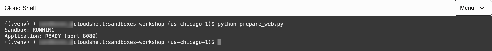
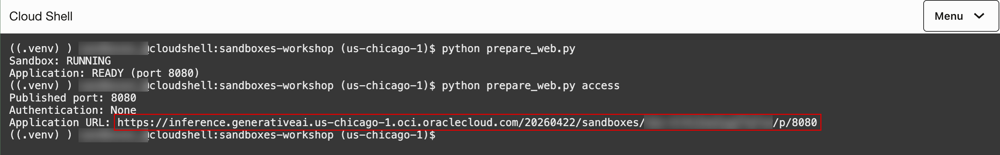
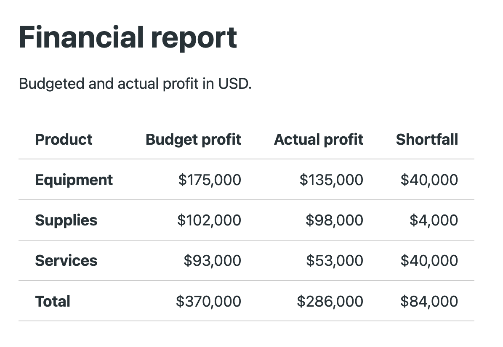

# Publish a sandbox application and access it from your browser

## Introduction

In this lab, you will run a small web application inside an OCI Sandbox to display a financial report from the sample CSV. You will publish the application's port, open its HTTPS URL in your browser, and learn when the application developer needs to add authentication and authorization.

### Objectives

* Run a web application inside an OCI Sandbox.
* Publish its listening port and access the application through its HTTPS URL.
* Distinguish inbound application access from outbound network access.
* Understand who can access a public endpoint and when application authentication is needed.

Estimated Time: 10 minutes (optional extension).

### Prerequisites

* Complete Lab 1: Setup.

## Task 1: Run a web application in a sandbox

You will run a small Python web application that displays budgeted profit, actual profit and shortfall from the sample CSV. The application listens on port `8080` inside a new sandbox. The setup script publishes this port when it creates the sandbox. In the next task, you will inspect those settings and retrieve the application URL.

1. In Cloud Shell, use the workshop folder and Python environment prepared in Lab 1. If you opened a new Cloud Shell session, run:

    ```bash
    <copy>
    cd ~/sandboxes-workshop
    source .venv/bin/activate
    </copy>
    ```

2. Run the web application setup script included in `sandboxes-workshop.zip`:

    ```bash
    <copy>
    python prepare_web.py
    </copy>
    ```

    The script uses the project and region saved in `config.json`. It creates a **Small** Python sandbox named `workshop-web` with a 60-minute lifetime, then uploads `web_app.py` and `monthly-financials.csv`. It publishes port `8080` and saves the sandbox and command IDs in `web-state.json` for the following task and for retries.

    Review the published-port settings in [prepare_web.py](../files/sandboxes-workshop/prepare_web.py). The script supplies these settings when creating the sandbox:

    <!-- source: prepare_web.py -->

    ```python
    CreateSandboxDetails(
        display_name='workshop-web',
        runtime='python-3.11',
        shape='SMALL',
        expiration_duration='PT60M',
        publish_ports=['8080'],
    ),
    ```

    `publish_ports` identifies the application's listening port. This lab omits `published_port_auth_mode` and uses public access. You will check the returned mode in Task 2. Publishing a port does not require changing the project's outbound domain allowlist.

    Choose access controls based on who needs to use the application:

    * **Public access:** When the returned authentication mode is `None`, anyone with the URL can access the application. This example serves sample data without a login.
    * **OCI IAM protection:** Add `published_port_auth_mode='OCI_IAM'` to `CreateSandboxDetails` when creating the sandbox. Each HTTP request or WebSocket handshake must use OCI authentication. Callers need permission to use sandboxes and read the owning project. A browser navigation does not trigger an OCI login page; clients must sign their requests.
    * **Application authentication:** For browser users, the application can provide a login through an identity provider and check which pages or actions each user may access. The application developer implements these controls. They do not replace OCI authentication when `OCI_IAM` is enabled.

    > **Note:** The published-port authentication mode is fixed when the sandbox is created. To change it, create a new sandbox with the desired setting.

    In [prepare_web.py](../files/sandboxes-workshop/prepare_web.py), `run_sandbox_command()` starts `web_app.py` inside the sandbox and returns its command ID while the application continues running:

    <!-- source: prepare_web.py -->

    ```python
    command = client.run_sandbox_command(
        state['sandbox_id'],
        RunSandboxCommandDetails(
            command='python',
            args=['/workspace/web_app.py'],
            timeout='PT60M',
        ),
        opc_retry_token=state['start_token'],
    ).data
    ```

    The application calculates profit as revenue minus COGS and freight, then displays the product figures and totals as an HTML table. It uses Python's built-in HTTP server. In [web_app.py](../files/sandboxes-workshop/web_app.py), these lines start the server:

    <!-- source: web_app.py -->

    ```python
    server = ThreadingHTTPServer(
        ('0.0.0.0', 8080), ReportHandler,
    )
    server.serve_forever()
    ```

    `0.0.0.0` makes the server listen on the sandbox's network interfaces. `8080` is the published application port. `ReportHandler` responds to requests for `/` with the financial report. The server keeps running to handle subsequent requests.

3. Confirm that the script displays:

    

    The script checks readiness by sending an HTTP request to `http://127.0.0.1:8080/` from inside the sandbox. A successful response confirms that the application is serving the report. This address refers to the sandbox itself; Task 2 will provide the URL to use in your browser.

## Task 2: Access the application from your browser

Publishing a port gives the application an HTTPS endpoint outside the sandbox. This is **inbound access**: a client sends a request to the application. The project's **outbound rules** control connections initiated by code inside the sandbox, such as the Object Storage requests in Lab 2.

1. In Cloud Shell, retrieve the published URL and authentication mode:

    ```bash
    <copy>
    python prepare_web.py access
    </copy>
    ```

    The script reads the sandbox ID from `web-state.json`, calls `get_sandbox()`, and finds the published-port entry with key `8080`. That entry's value is the application URL.

2. Confirm that the output shows **Published port: 8080**, **Authentication: None**, and an **Application URL** beginning with `https://`.

    > **Note:** If the returned mode is `OCI_IAM`, the service requires OCI-signed requests instead of direct browser access. Signing in to the OCI Console does not authenticate requests to that URL.

3. Copy the **Application URL** and open it in a new browser tab.

    

4. Confirm that the **Financial report** page loads. Review the **Budget profit**, **Actual profit** and **Shortfall** columns for each product and the **Total** row. The figures come from the sample CSV uploaded in Task 1; the application calculates and serves the report from inside the sandbox.

    

## Learn More

* [Published-port configuration and authentication](https://docs.oracle.com/en-us/iaas/tools/oci-cli/latest/oci_cli_docs/cmdref/generative-ai-sandbox/sandbox/create.html)
* [Running a service on a published port](https://docs.oracle.com/en-us/iaas/Content/generative-ai/run-sandbox-commands.htm)

## Acknowledgements

* **Author** - Yanir Shahak
* **Last Updated By/Date** - Yanir Shahak, October 2026
