# Run AI-generated code

## Introduction

In this lab, you will compare budgeted and actual profit using sample financial data. You will use the OCI Responses API with `openai.gpt-oss-120b` to generate Python code for the analysis. An OCI Sandbox will read the CSV from a private Object Storage bucket and execute the code. You will return the execution results to the model so it can interpret them and answer the original request.

<style>
#module-content img[src$="responses-information-flow.svg"] { width: 900px; max-width: 100%; }
</style>

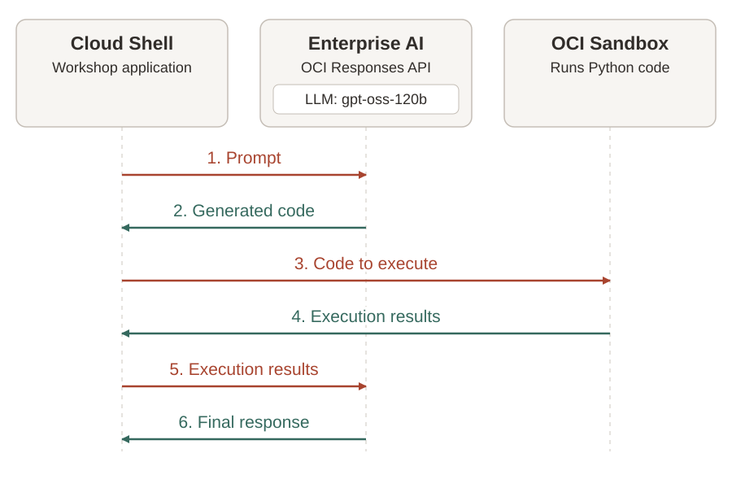

### Objectives

* Upload the sample CSV to a private Object Storage bucket.
* Create a sandbox.
* Grant it access to a private Object Storage bucket using IAM and outbound network controls.
* Generate Python code with the OCI Responses API and execute it in the sandbox.
* Inspect the execution results and return them to the model for a complete response.

Estimated Time: 30 minutes.

## Task 1: Prepare the sample data

The sample CSV contains budgeted and actual revenue, cost of goods sold (COGS), and freight costs for Equipment, Supplies, and Services. You will ask the model to generate Python code that compares budgeted and actual profit, calculated as revenue minus COGS and freight. The code will run in a sandbox and read the CSV from Object Storage.

1. Download [monthly-financials.csv](../files/monthly-financials.csv).

2. In the OCI Console, open the navigation menu and select **Storage**. Under **Object Storage & Archive Storage**, click **Buckets**.

    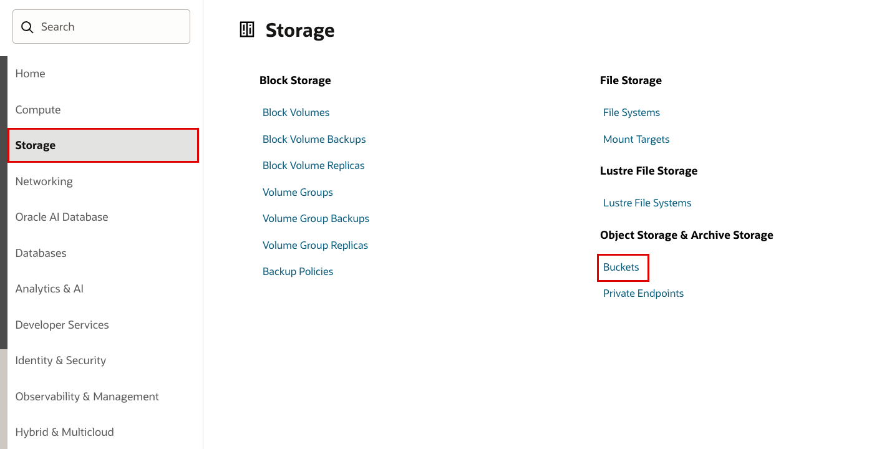

    Use the **Compartment** filter to select your workshop compartment, then click **Create bucket**.

    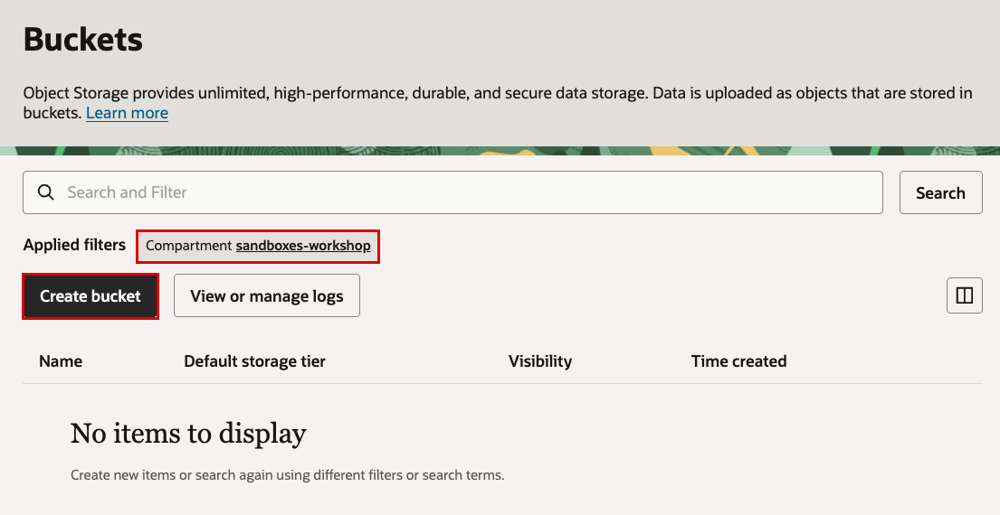

3. For **Bucket name**, enter `sandboxes-workshop-data`.

    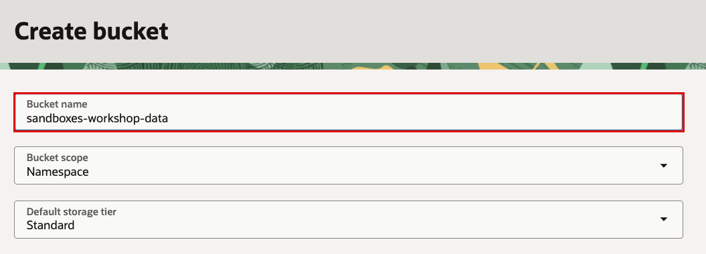

    Leave the remaining settings at their defaults and click **Create bucket**.

    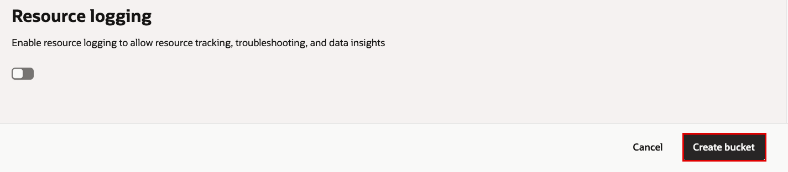

4. Click the name of the bucket you created.

    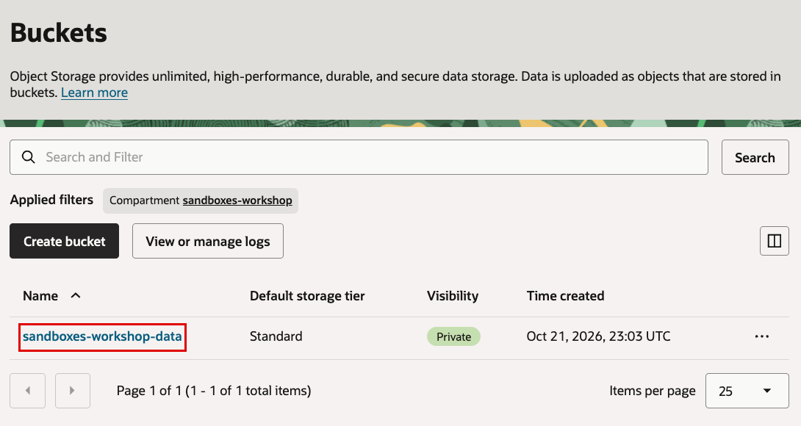

    Click **Objects**, then **Upload objects**.

    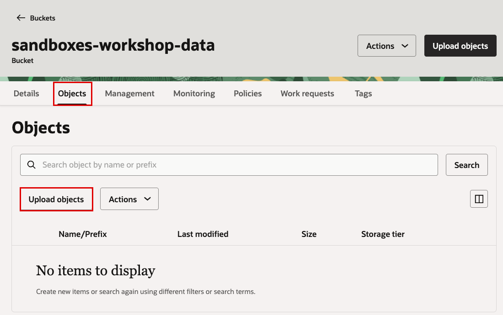

    Under **Choose Files from your Computer**, click **Drop a file or select one** and choose the downloaded `monthly-financials.csv`. Leave the remaining settings at their defaults and click **Next**.

    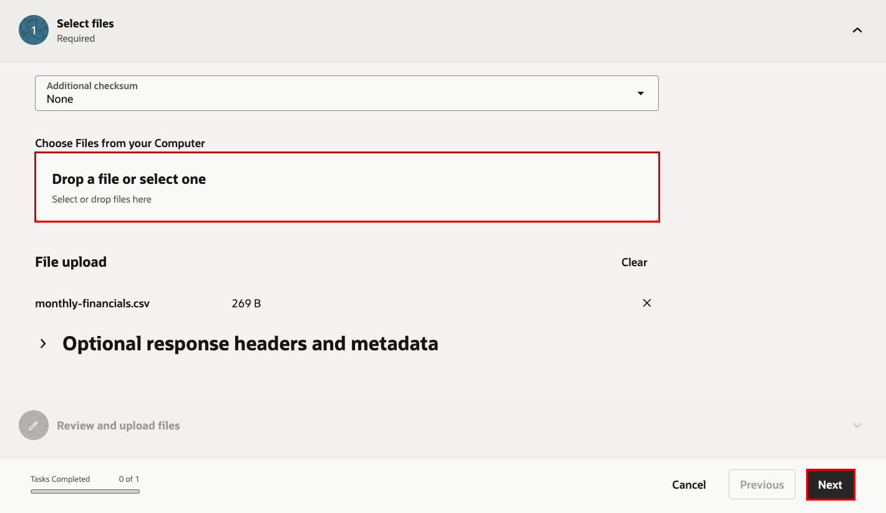

    In **Review and upload files**, click **Upload objects**.

    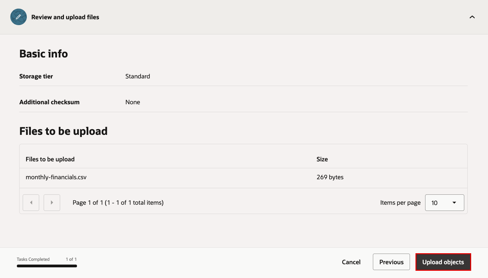

5. When the file shows **Done**, click **Close**.

    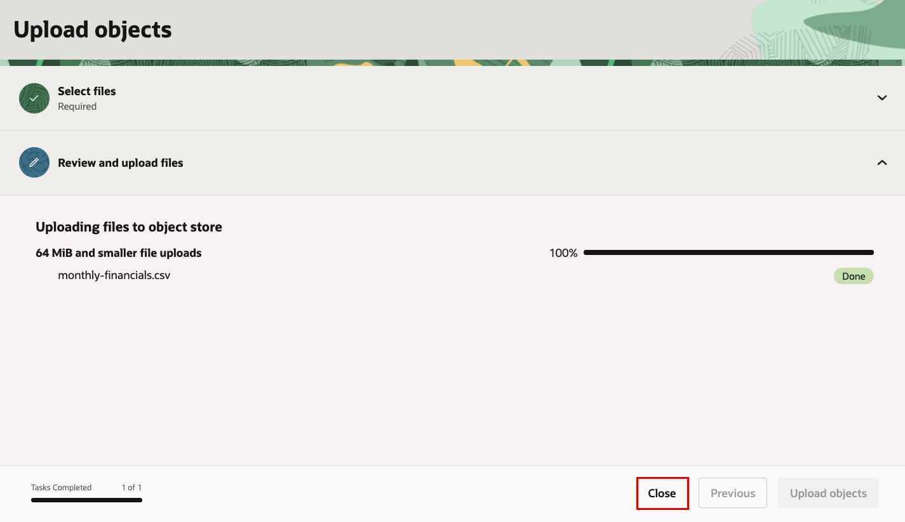

    Confirm that `monthly-financials.csv` appears in the **Objects** list. You will use this bucket name and object name in the following tasks.

## Task 2: Grant the sandbox access to the data

Code inside a sandbox uses its resource principal to authenticate to OCI services. Grant it permission to read objects in the workshop bucket. This policy is required even when your user has administrator access.

1. In Cloud Shell, run the policy script included in `sandboxes-workshop.zip`. It prints the policy statement using the compartment and project OCIDs saved in `config.json` during Lab 1.

    If you used a different bucket name in Task 1, replace `"sandboxes-workshop-data"` with that name, keeping the quotes:

    ```bash
    <copy>
    python generate_policy.py "sandboxes-workshop-data"
    </copy>
    ```

    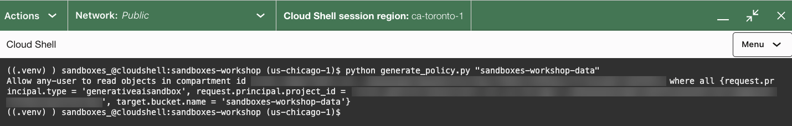

    Copy the printed statement. The `where all` conditions restrict access to sandboxes in your project and objects in the bucket you specified.

2. In the OCI Console, open **Identity & Security → Policies**.

    

    Select your workshop compartment in the compartment filter and click **Create Policy**.

    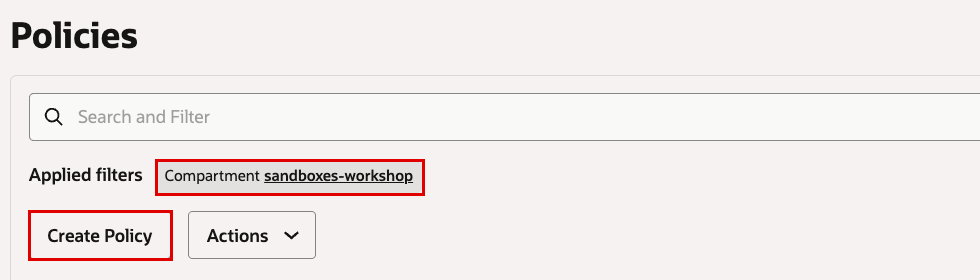

    Enter these details:

    * **Name:** `sandboxes-workshop-data-access`
    * **Description:** `Allow workshop sandboxes to read the sample data`
    * **Compartment:** Select your workshop compartment.

3. Under **Policy Builder**, click **Show manual editor**.

    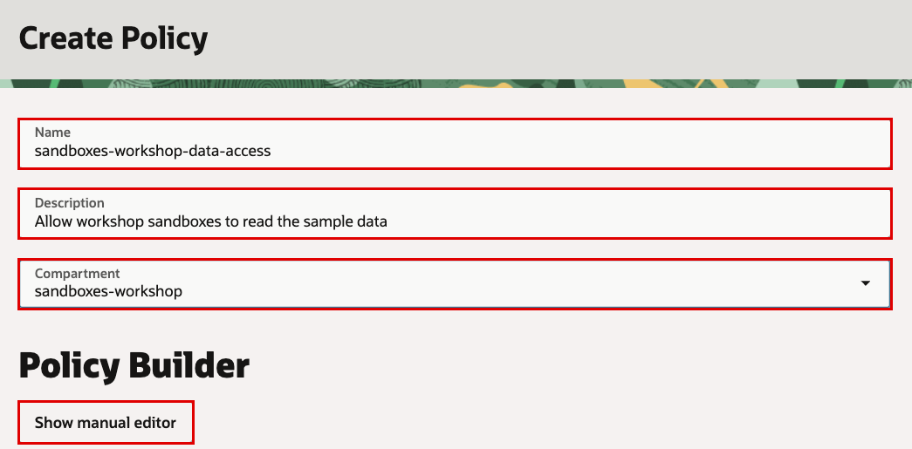

    Paste the statement from step 1, then click **Create**.

    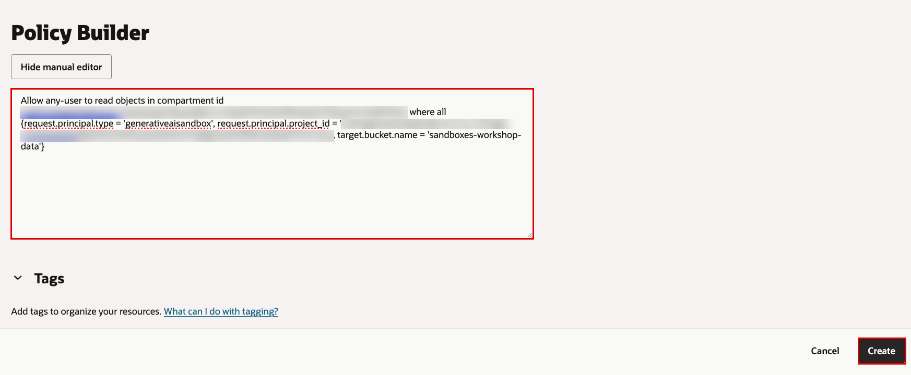

4. Confirm that `sandboxes-workshop-data-access` shows **Active**. Click **Statements** to check the saved policy.

    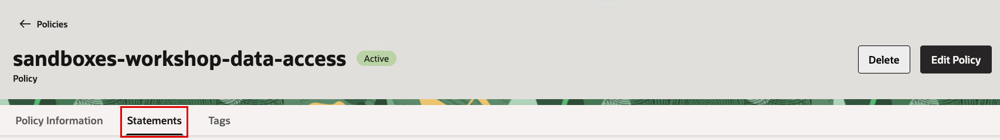

## Task 3: Create a sandbox and access Object Storage

The policy from Task 2 grants the sandbox permission to read your bucket. The project's `DENY_ALL` setting still blocks the network connection. You will observe that restriction, allow the Object Storage endpoint, and retry the read.

1. In Cloud Shell, run the sandbox script from the workshop folder. If you used a different bucket name in Task 1, replace `"sandboxes-workshop-data"` with that name:

    ```bash
    <copy>
    python sandbox_access.py create "sandboxes-workshop-data"
    </copy>
    ```

    The script prints your project name, bucket name and **Object Storage hostname**, then creates a **Small** Python sandbox with a 60-minute lifetime. It saves the sandbox ID and bucket details in `config.json`. Wait until the output shows **RUNNING**.

    In [sandbox_access.py](../files/sandboxes-workshop/sandbox_access.py), the creation request runs in Cloud Shell using your OCI identity. Its core settings are:

    <!-- source: sandbox_access.py -->

    ```python
    sandbox = client.create_sandbox(
        config['project_id'],
        CreateSandboxDetails(
            display_name='workshop-analysis',
            runtime='python-3.11',
            shape='SMALL',
            expiration_duration='PT60M',
        ),
        opc_retry_token=config['sandbox_create_token'],
    ).data
    config['sandbox_id'] = sandbox.id
    ```

    `project_id` associates the sandbox with your project's settings. `CreateSandboxDetails` specifies its runtime, size and lifetime. The returned `sandbox.id` identifies it for later API calls.

2. Attempt to read the CSV from inside the sandbox:

    ```bash
    <copy>
    python sandbox_access.py read
    </copy>
    ```

    The script uploads `read_csv.py` and runs it in the sandbox. This code uses the sandbox's resource principal to request `monthly-financials.csv` from your bucket.

    Inside the sandbox, [read_csv.py](../files/sandboxes-workshop/read_csv.py) uses these OCI SDK calls to authenticate and request the object:

    <!-- source: read_csv.py -->

    ```python
    client = oci.object_storage.ObjectStorageClient(
        {'region': region},
        signer=(
            oci.auth.signers.get_resource_principals_signer()
        ),
        service_endpoint=endpoint,
        timeout=(5, 15),
        retry_strategy=oci.retry.NoneRetryStrategy(),
    )
    ```

    It then requests the CSV:

    <!-- source: read_csv.py -->

    ```python
    response = client.get_object(
        namespace, bucket, 'monthly-financials.csv',
    )
    ```

    `get_resource_principals_signer()` authenticates as the sandbox. `get_object()` requests the CSV from the specified namespace and bucket. The IAM policy from Task 2 authorizes this request. The project's network policy controls whether it can reach the endpoint. A successful read saves the response bytes to `/workspace/monthly-financials.csv`.

    With `DENY_ALL`, the connection fails with **Exit code: 1**:

    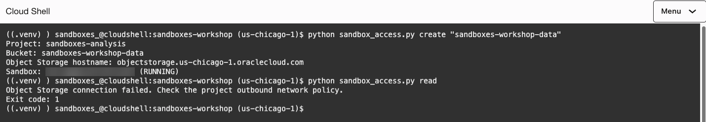

    IAM permission is already in place. The blocked connection demonstrates that network access must also be allowed.

3. To allow the sandbox to reach Object Storage, open the OCI Console navigation menu and click **Analytics & AI**, then **Generative AI**.

    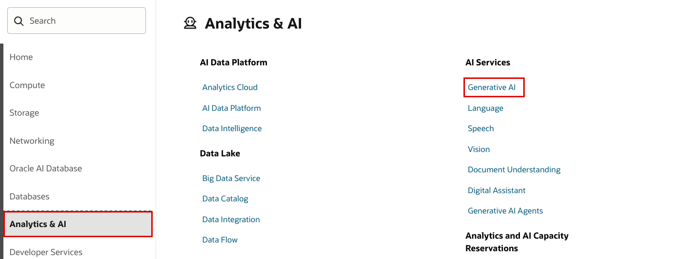

    Click **Projects**. Select your workshop compartment and click the project you created in Lab 1.

    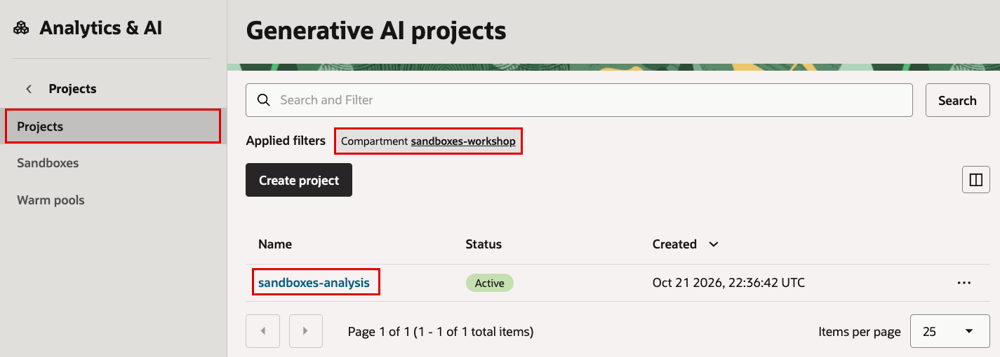

    Click **Actions**, then **Edit**.

    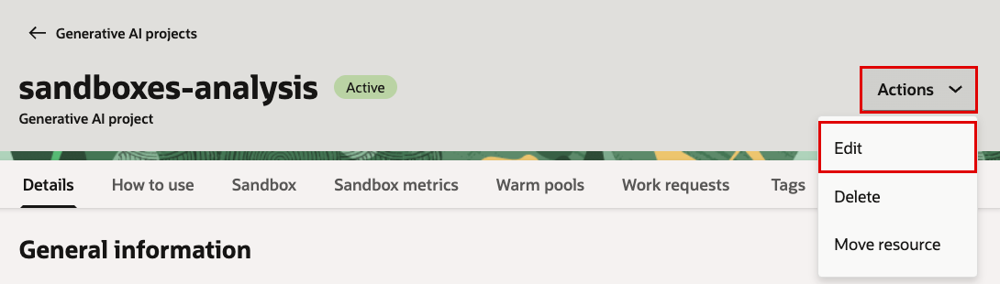

    Under **Sandbox configuration**, enter these settings:

    * **Network policy mode:** Select `ALLOW`.
    * **Allowed domain:** Enter the **Object Storage hostname** printed in step 1, such as `objectstorage.us-chicago-1.oraclecloud.com`.
    * **Ports:** Enter `443` for HTTPS.

    Click **Update**.

    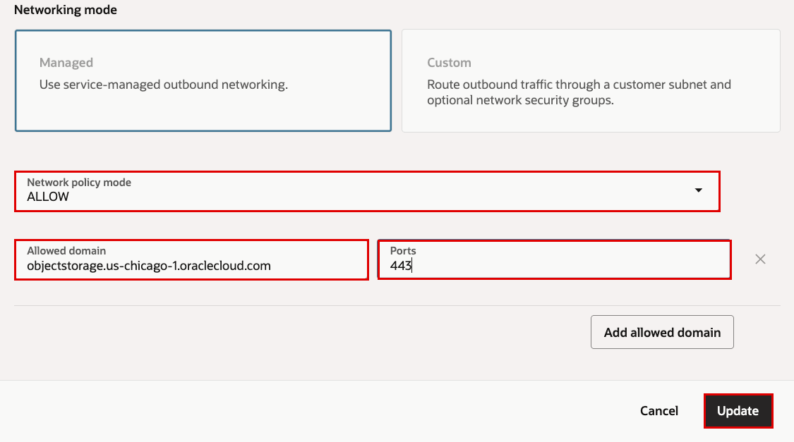

4. In Cloud Shell, retry the read in the same sandbox:

    ```bash
    <copy>
    python sandbox_access.py read
    </copy>
    ```

    Confirm that the output shows your bucket name, the CSV contents and **Exit code: 0**. The CSV is now saved at `/workspace/monthly-financials.csv` inside the sandbox for the analysis.

    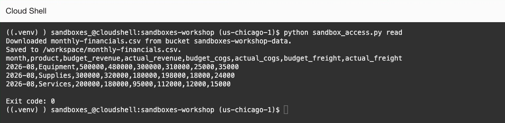

    If Object Storage returns HTTP `403` or `404`, check that the bucket name matches Task 1 and the policy from Task 2. Confirm that `monthly-financials.csv` appears in the bucket. If you just created the policy, wait a minute and retry.

## Task 4: Generate and run analysis code

The [analysis.py](../files/sandboxes-workshop/analysis.py) script in your workshop folder acts as the application. It calls the OCI Responses API from Cloud Shell using your OCI identity. It reads the region and project from `config.json`. The generated Python code runs inside the sandbox. The excerpts below show the API calls behind each step.

1. In Cloud Shell, ask the model to generate the analysis code:

    ```bash
    <copy>
    python analysis.py generate
    </copy>
    ```

    The script sends this question with the CSV column names, its sandbox path, and the profit calculation:

    > Which products have the largest profit shortfall, and what is the total shortfall?

    The script creates a conversation so OCI Enterprise AI can retain the question and model responses. It defines a function tool named `run_python` with one argument, `code`. This call asks `openai.gpt-oss-120b` to return Python code through that tool:

    <!-- source: analysis.py -->

    ```python
    conversation = api.conversations.create()
    response = api.responses.create(
        model=MODEL,
        input=QUESTION,
        conversation=conversation.id,
        instructions=INSTRUCTIONS,
        tools=[TOOL],
        tool_choice='required',
        parallel_tool_calls=False,
        max_output_tokens=4000,
    )
    ```

    `QUESTION` contains the question. `INSTRUCTIONS` describes the input data and required output. `TOOL` defines the function's arguments. The response contains a `function_call` with the generated code and a `call_id`. The application decides when to execute that code. An application can also add a code review before execution.

    The script saves the code as `generated-analysis.py` and the conversation ID and `call_id` in `analysis-state.json`.

    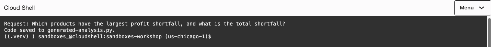

2. Execute the generated code in the sandbox:

    ```bash
    <copy>
    python analysis.py run
    </copy>
    ```

    The script uses the sandbox ID saved in Task 3. It calls the `run_script()` helper in `sandbox_access.py`. The helper uploads the Python file with `write_sandbox_file()`, then starts Python with `run_sandbox_command_and_wait()`:

    <!-- source: sandbox_access.py -->

    ```python
    remote_path = f'/workspace/{script.name}'
    with script.open('rb') as code:
        client.write_sandbox_file(
            sandbox_id, remote_path, code,
        )
    output = client.run_sandbox_command_and_wait(
        sandbox_id,
        RunSandboxCommandDetails(
            command='python',
            args=[remote_path, *args],
            timeout='PT45S',
        ),
        retry_strategy=oci.retry.NoneRetryStrategy(),
    ).data.output
    ```

    The generated code reads `/workspace/monthly-financials.csv` and writes `/workspace/analysis-result.json`. The returned `output` contains standard output (`stdout`), errors (`stderr`) and the exit code. Look for **Exit code: 0** and **Result saved to analysis-result.json**. If execution fails, resolve the displayed error before continuing.

    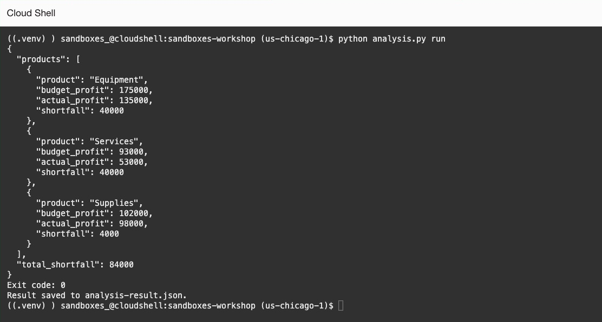

    After the generated code finishes successfully, `analysis.py` downloads the result file from the sandbox to Cloud Shell:

    <!-- source: analysis.py -->

    ```python
    response = client.read_sandbox_file(
        config['sandbox_id'],
        '/workspace/analysis-result.json',
    )
    result = json.loads(response.data.content)
    RESULT.write_text(json.dumps(result, indent=2) + '\n')
    ```

    This transfers the calculated results from the sandbox to the application. For the supplied CSV, expect these amounts in USD:

    | Product | Budget profit | Actual profit | Shortfall |
    | --- | ---: | ---: | ---: |
    | Equipment | 175,000 | 135,000 | 40,000 |
    | Supplies | 102,000 | 98,000 | 4,000 |
    | Services | 93,000 | 53,000 | 40,000 |
    | **Total** | **370,000** | **286,000** | **84,000** |

3. Return the calculated results to the model:

    ```bash
    <copy>
    python analysis.py explain
    </copy>
    ```

    The script builds a `function_call_output` containing the downloaded JSON. Its `call_id` connects the result to the model's earlier request to run Python:

    <!-- source: analysis.py -->

    ```python
    tool_output = {
        'type': 'function_call_output',
        'call_id': state['call_id'],
        'output': RESULT.read_text(),
    }
    ```

    The script sends this result to the same model, using the saved conversation ID:

    <!-- source: analysis.py -->

    ```python
    with responses_client(config) as api:
        response = api.responses.create(
            model=MODEL,
            input=[tool_output],
            conversation=state['conversation_id'],
            tools=[TOOL],
            tool_choice='none',
            max_output_tokens=2000,
            instructions=(
                'Answer the original question '
                'using the tool result. Include ties '
                'and the total shortfall in USD.'
            ),
        )
    if (
        response.status != 'completed'
        or not response.output_text.strip()
    ):
        raise RuntimeError(
            'The explanation did not complete. '
            'Rerun the explain action.'
        )
    print(response.output_text)
    ```

    OCI Enterprise AI supplies the earlier context using the conversation ID. The script sets `tool_choice='none'` to request a final explanation. The short-term memory compaction enabled in Lab 1 compresses earlier context as the conversation grows. Conversation history works with or without compaction.

    Confirm that the answer identifies Equipment and Services as tied for the largest profit shortfall, at **$40,000 each**. The total shortfall should be **$84,000**. The model's wording can vary; the figures should match the execution results.

    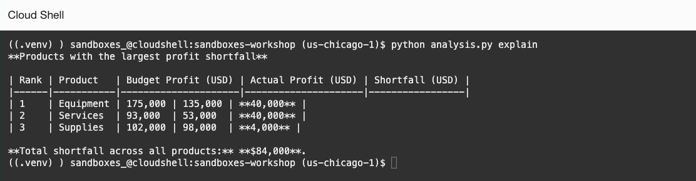

## Learn More

* [Creating an Object Storage bucket](https://docs.oracle.com/en-us/iaas/Content/Object/Tasks/managingbuckets_topic-To_create_a_bucket.htm)
* [Uploading objects to a bucket](https://docs.oracle.com/en-us/iaas/Content/Object/Tasks/managingobjects_topic-To_upload_objects_to_a_bucket.htm)
* [Creating an IAM policy](https://docs.oracle.com/en-us/iaas/Content/Identity/policymgmt/managingpolicies_topic-To_create_a_policy.htm)
* [Object Storage IAM permissions and policy variables](https://docs.oracle.com/en-us/iaas/Content/Identity/Reference/objectstoragepolicyreference.htm)
* [OCI Responses API](https://docs.oracle.com/en-us/iaas/Content/generative-ai/responses-api.htm)
* [OCI Conversations API](https://docs.oracle.com/en-us/iaas/Content/generative-ai/conversations-api.htm)
* [Short-term memory compaction](https://docs.oracle.com/en-us/iaas/Content/generative-ai/use-short-term-memory.htm)
* [Function calling with the Responses API](https://developers.openai.com/api/docs/guides/function-calling)

## Acknowledgements

* **Author** - Yanir Shahak
* **Last Updated By/Date** - Yanir Shahak, October 2026
