# Setup

## Introduction

Complete this setup once to prepare the environment you will reuse throughout the workshop's exercises.

### Objectives

* Select a region and compartment for the workshop resources.
* Create the required OCI IAM policies.
* Set up Python and the workshop files in OCI Cloud Shell.
* Create a project and configure its Sandbox settings.

Estimated Time: 30 minutes.

## Task 1: Select a region and compartment

1. The OCI Responses API exercises use **OpenAI gpt-oss-120b**, with the model ID `openai.gpt-oss-120b`, in on-demand mode. Open Oracle's [Models by Region table](https://docs.oracle.com/en-us/iaas/Content/generative-ai/model-endpoint-regions.htm), find the **OpenAI gpt-oss-120b** row, and choose a region with on-demand availability, such as **US Midwest (Chicago)** (`us-chicago-1`).

    Sign in to the OCI Console, open the **Region** menu in the top navigation bar, and select that region. Keep this region selected throughout the labs.

    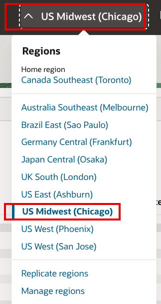

    If your tenancy is not subscribed to the region you need, follow **Subscribing to an Infrastructure Region** in the **Learn More** section, then return here and select that region.

2. Open the navigation menu and select **Identity & Security → Compartments**. A compartment groups the OCI resources you will create during the workshop.

    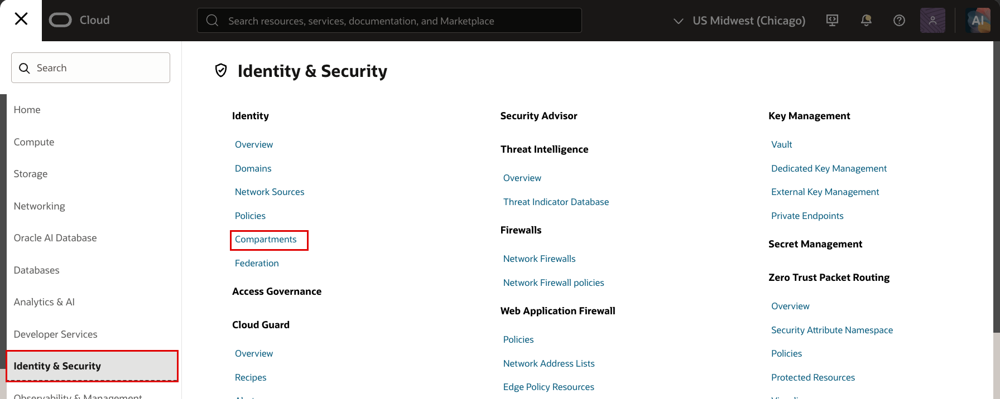

    If you already have a compartment you want to use, note its name and skip the remaining steps in this task.

3. On the **Compartments** page, click **Create compartment**. Leave **Parent compartment** set to your tenancy's root compartment.

    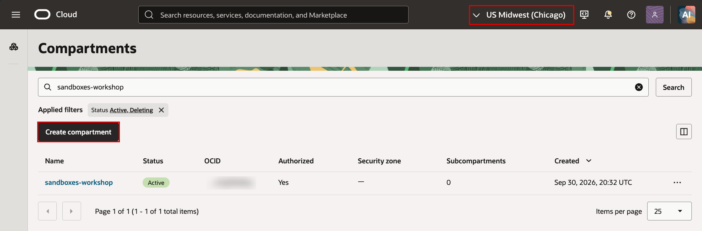

4. Complete the form:

    * **Name:** Enter `sandboxes-workshop`, or another name that is unique within the parent compartment.
    * **Description:** Enter `Resources for the OCI Sandboxes workshop`.
    * **Parent compartment:** Confirm that your tenancy's **root compartment** is selected. Choose another parent only if you intentionally want to place the workshop compartment inside it.

    Click **Create compartment**.

    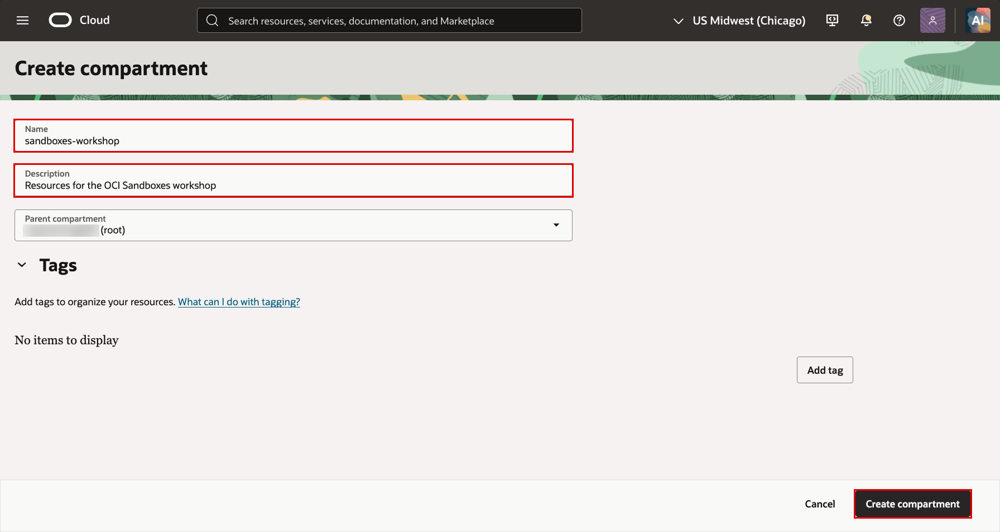

5. Confirm that the new compartment appears in the list with the state **Active**. Note its name so you can select it in the following tasks.

## Task 2: Configure IAM permissions

1. Identify the two identities that need access to OCI services:

    * **Workshop user:** Your OCI user opens Cloud Shell, creates and manages projects and sandboxes, and calls the OCI Responses API. IAM policies grant these permissions through the groups the user belongs to. If you are preparing access for other users, identify the IAM group that should receive these permissions.
    * **Sandbox resource principal:** Code running inside a sandbox uses the sandbox's own identity to call OCI services. In Lab 2, you will grant this identity permission to read the sample CSV from the workshop's Object Storage bucket, scoped to sandboxes in your project.

    If you have administrator access, you can skip creating the user-access policies below. Review them to learn how to grant other users the permissions they need. The sandbox's resource principal requires separate policies, even when you are an administrator. Grant it only the operations and resources its code needs.

2. Review the access required by the workshop user. When granting access to other users, assign these permissions to their IAM group:

    | Access | What it enables | Scope |
    | --- | --- | --- |
    | Cloud Shell | Open and use Cloud Shell (`use cloud-shell`). | Tenancy. |
    | Cloud Shell Public Network | Download workshop files and Python packages, and reach public API endpoints (`use cloud-shell-public-network`). | Tenancy. |
    | Projects | Create the workshop project, configure its settings, and delete it (`manage generative-ai-project`). | Workshop compartment. |
    | Models | List available models when selecting the compaction model (`inspect generative-ai-model`). | Workshop compartment. |
    | Sandboxes | Create and delete sandboxes, run commands, and transfer files. | Workshop compartment. |
    | OCI Responses API | Send requests to `openai.gpt-oss-120b` and return tool results to complete a response. | Compartment containing the workshop project. |
    | Object Storage | Create and view buckets, list objects, and upload or replace the sample CSV. | Workshop compartment. |

    Cloud Shell requires tenancy-level grants. Scope access to the workshop resources to their compartment.

    In Lab 2, you will create the bucket and grant the sandbox separate read access to it.

3. To grant access to other users, open **Identity & Security → Domains**.

    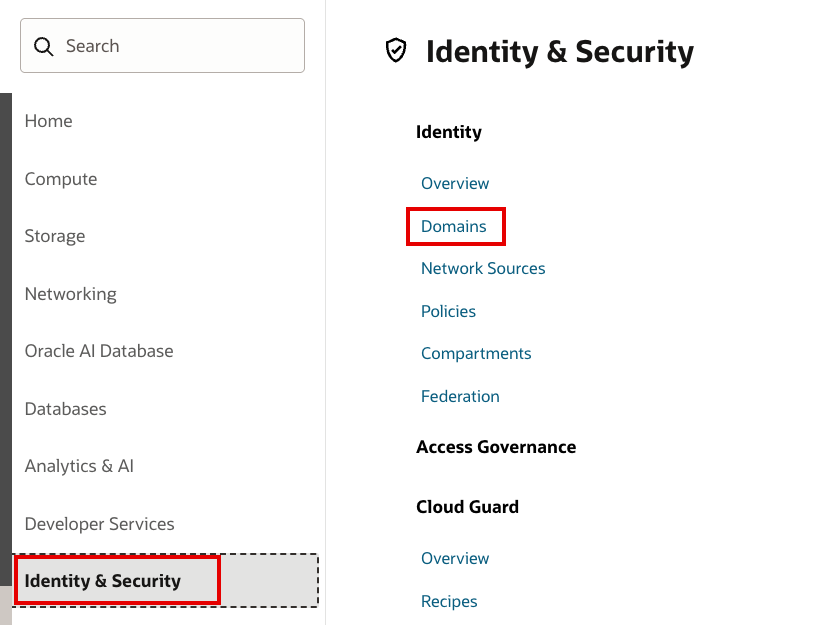

    Click the identity domain containing the workshop users.

    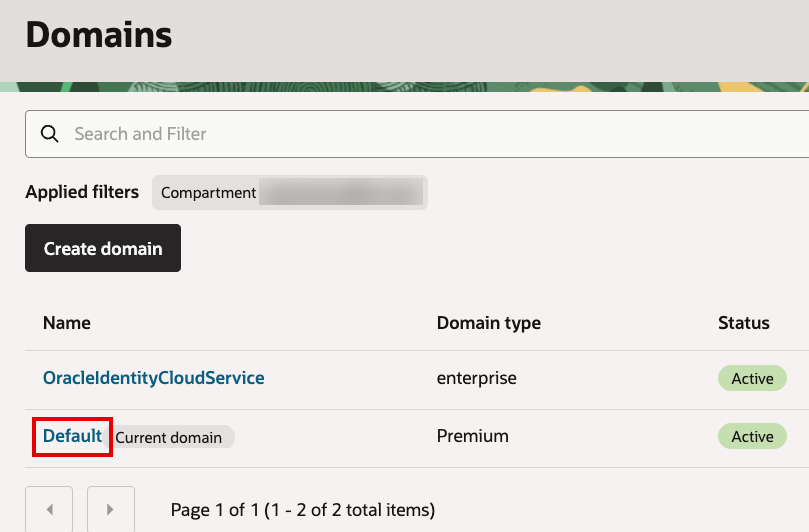

    Open **User management**, then scroll to **Groups**. If your Console shows Groups in the domain's navigation instead, open it there.

    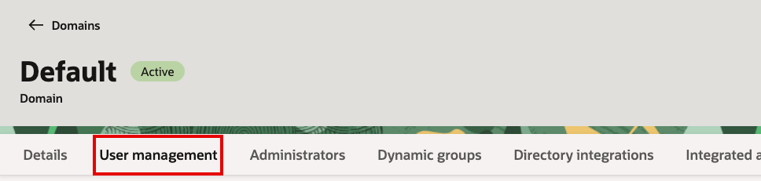

    If you already have a group containing the intended workshop users, click its name, copy its **OCID**, and continue to step 4.

    Otherwise, click **Create group**.

    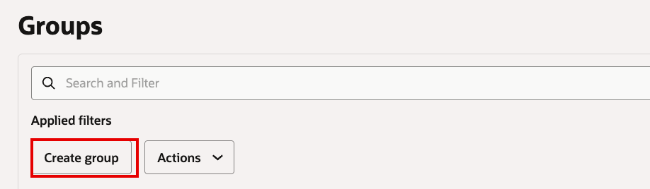

    Complete the form:

    * **Name:** Enter `sandboxes-workshop-users`.
    * **Description:** Enter `Users of the OCI Sandboxes workshop`.
    * **Users:** Select the users who should receive workshop access.

    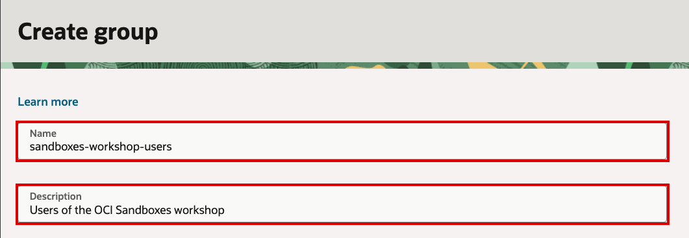

    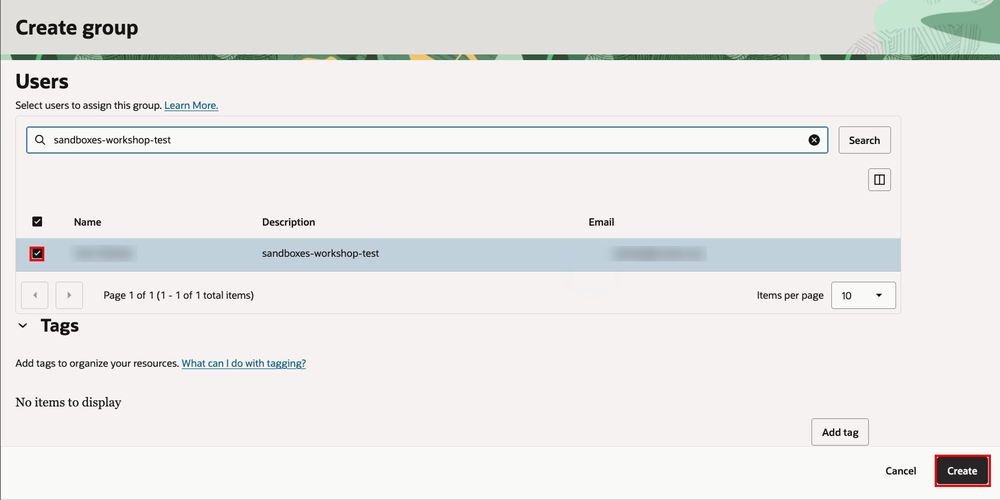

    Click **Create**. Copy the group's **OCID** from its details page.

    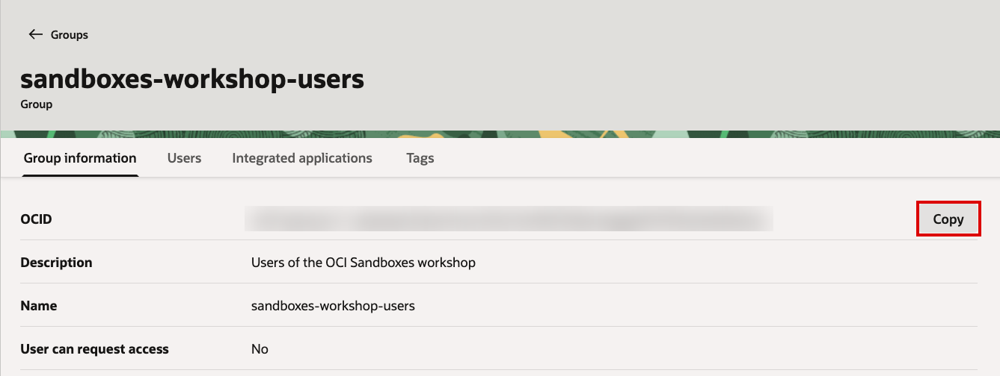

4. Open **Identity & Security → Compartments** and click your workshop compartment.

    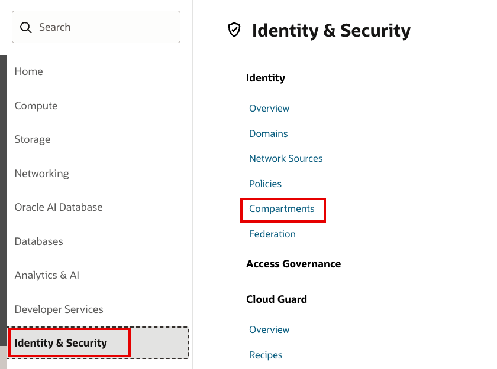

    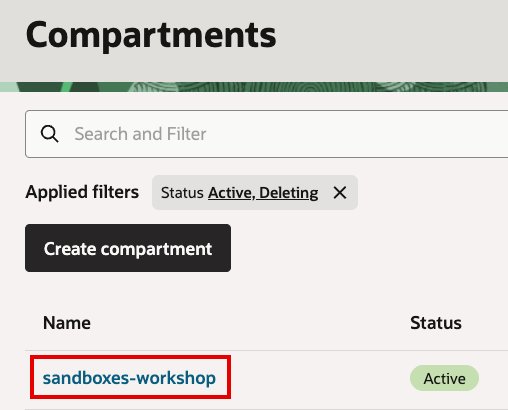

    Copy its **OCID**.

    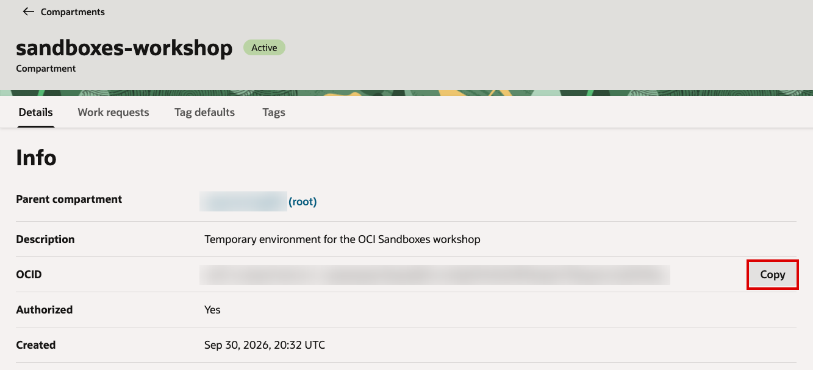

    The policy statements in step 6 use the placeholders below. Replace each placeholder with the corresponding OCID you copied:

    | Placeholder | Value to use |
    | --- | --- |
    | `<group-ocid>` | The OCID copied from the group's details. |
    | `<compartment-ocid>` | The OCID copied from the workshop compartment's details. |

5. Open **Identity & Security → Policies**, select the tenancy's **root compartment** in the compartment selector, and click **Create Policy**.

    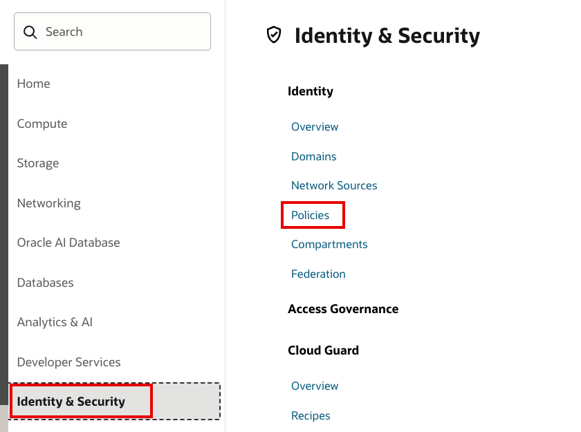

    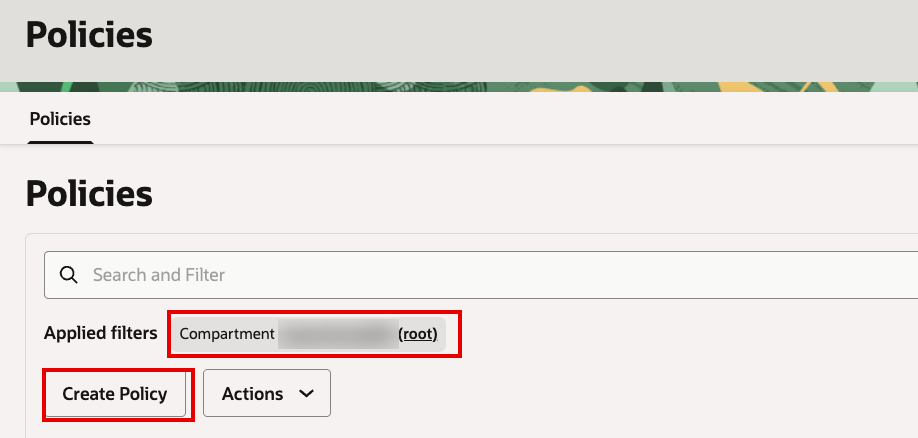

    Enter these basic details:

    * **Name:** `sandboxes-workshop-access`
    * **Description:** `User access to Cloud Shell and the OCI Sandboxes workshop resources`
    * **Compartment:** Your tenancy's root compartment.

    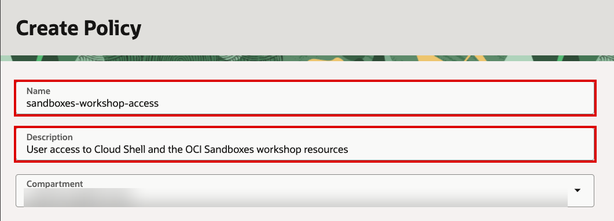

    The policy is stored at the root because it includes Cloud Shell grants that apply at tenancy level. The resource statements below restrict access to your workshop compartment.

6. Under **Policy Builder**, click **Show manual editor**. Copy the statements below and replace every placeholder with the values from step 4. Remove the angle brackets.

    ```text
    <copy>
    Allow group id <group-ocid> to use cloud-shell in tenancy
    Allow group id <group-ocid> to use cloud-shell-public-network in tenancy
    Allow group id <group-ocid> to manage generative-ai-project in compartment id <compartment-ocid>
    Allow group id <group-ocid> to manage generative-ai-sandbox in compartment id <compartment-ocid>
    Allow group id <group-ocid> to manage generative-ai-response in compartment id <compartment-ocid>
    Allow group id <group-ocid> to manage buckets in compartment id <compartment-ocid>
    Allow group id <group-ocid> to manage objects in compartment id <compartment-ocid>
    Allow group id <group-ocid> to inspect generative-ai-model in compartment id <compartment-ocid>
    </copy>
    ```

    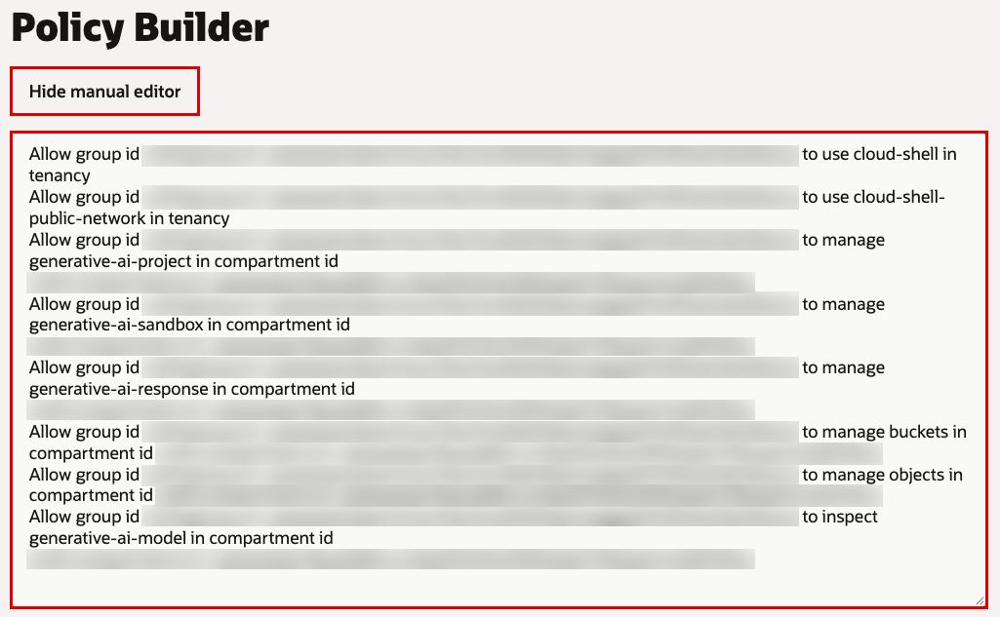

7. Check the group OCID and compartment OCID, then click **Create**. In the saved policy, open **Statements** and confirm that they match the values you entered.

    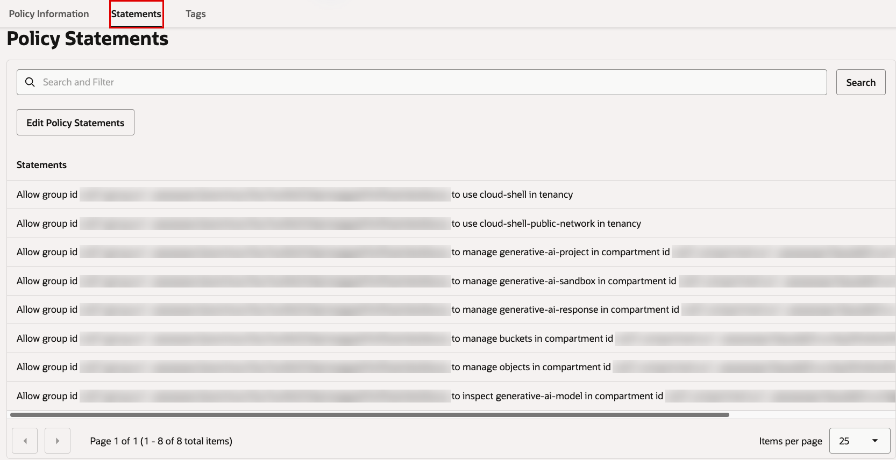

8. Users added to the group should sign in again before continuing. If their Cloud Shell session was already open, restart it from **Actions** to apply the Public Network grant.

    Check access using a member of the workshop group as you complete the following tasks. Testing with an administrator account alone does not show whether these grants are sufficient for other users.

## Task 3: Prepare Cloud Shell

1. In the OCI Console header, click **Developer tools** (the terminal icon), then click **Cloud Shell**. If prompted to run the Cloud Shell tutorial, enter `N`. Wait for the command prompt. Cloud Shell runs the workshop's Python code and authenticates OCI requests as your signed-in user.

    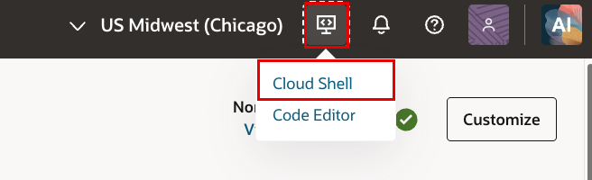

2. In Cloud Shell, open the **Network** menu and select **Public network**. If it already shows **Public**, continue. This provides the internet access needed to download Python packages and call OpenAI in the agent exercise.

    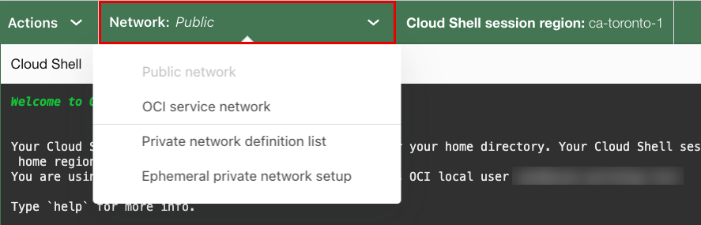

    If **Public network** is unavailable, check the grant from Task 2 and restart Cloud Shell from **Actions**.

3. Download [sandboxes-workshop.zip](../files/sandboxes-workshop.zip). In Cloud Shell, click **Menu**, then **Upload**.

    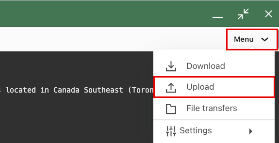

    Click **Select from your computer**, select the downloaded ZIP, then click **Upload** to upload it to your home directory.

    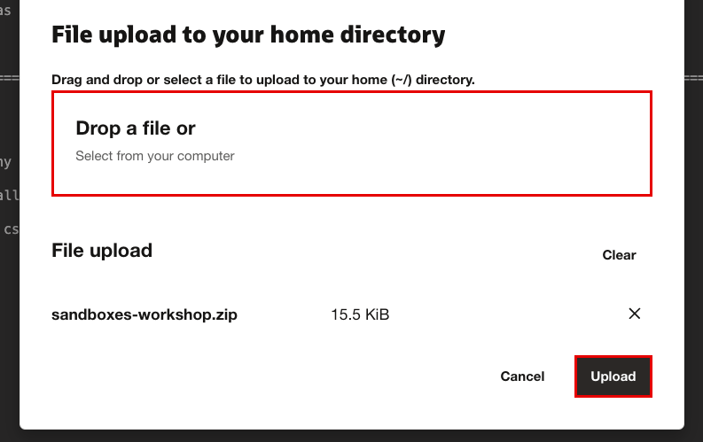

    Wait for **Progress** to show **Completed**, then click **Close**.

    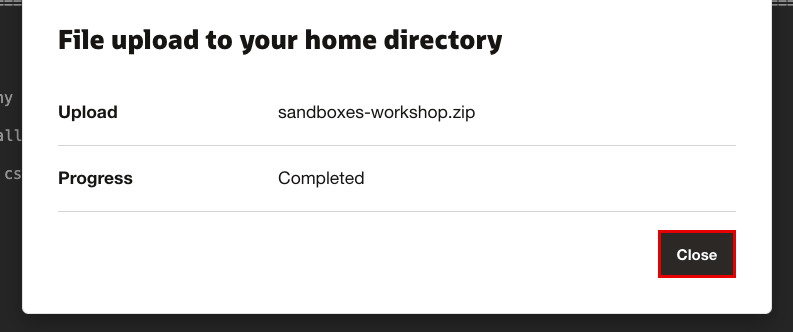

4. Run the setup script in Cloud Shell. If you chose a different compartment in Task 1, replace `"sandboxes-workshop"` with its name, keeping the quotes:

    ```bash
    <copy>
    unzip -n ~/sandboxes-workshop.zip -d ~ &&
    bash ~/sandboxes-workshop/setup.sh "sandboxes-workshop" &&
    cd ~/sandboxes-workshop &&
    source .venv/bin/activate
    </copy>
    ```

    The setup script installs the required Python packages, saves your region and compartment in `config.json`, and checks connectivity and initial OCI access. Each check shows **✓** for success or **✗** with instructions for resolving the error.

    After setup succeeds, `cd` opens the workshop folder and `source .venv/bin/activate` activates its Python environment. The remaining exercises use `python` to run scripts with the packages installed for this workshop.

    The setup script uses the compartment name you supplied and the OCI CLI target region, set from the Console region selected when you started Cloud Shell. If it cannot find that compartment or finds multiple compartments with that name, it asks you to choose from a numbered list. For duplicate names, compare the listed OCIDs with your compartment's OCID under **Identity & Security → Compartments**.

5. In the setup script's output, check these two lines:

    * **Region:** Compare this value with the region identifier you chose in Task 1, such as `us-chicago-1` for **US Midwest (Chicago)**.
    * **Compartment:** Compare this value with the compartment name you supplied to the setup script.

    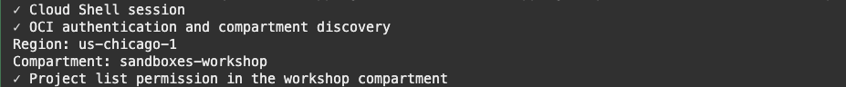

    If the region differs, select the Task 1 region in the Console, restart Cloud Shell, and rerun the setup script. If the compartment differs, rerun the setup script with the correct compartment name. Continue to Task 4 when the values match and the output shows **Ready for project creation**.

    If you restart Cloud Shell later, return to the workshop folder and reactivate the environment:

    ```bash
    <copy>
    cd ~/sandboxes-workshop && source .venv/bin/activate
    </copy>
    ```

## Task 4: Create a project with Sandboxes enabled

1. In the OCI Console, open the navigation menu in the upper-left corner and select **Analytics & AI**. Under **AI Services**, click **Generative AI**.

    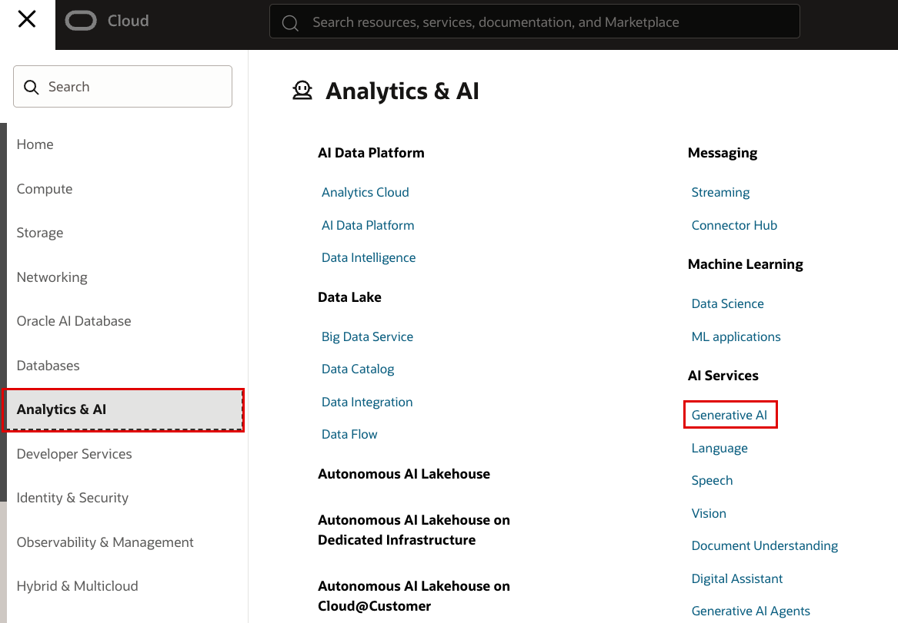

    In the Generative AI navigation menu, click **Projects**. If the menu is collapsed, click **Expand** first. Set the **Compartment** filter to your workshop compartment, then click **Create project**.

    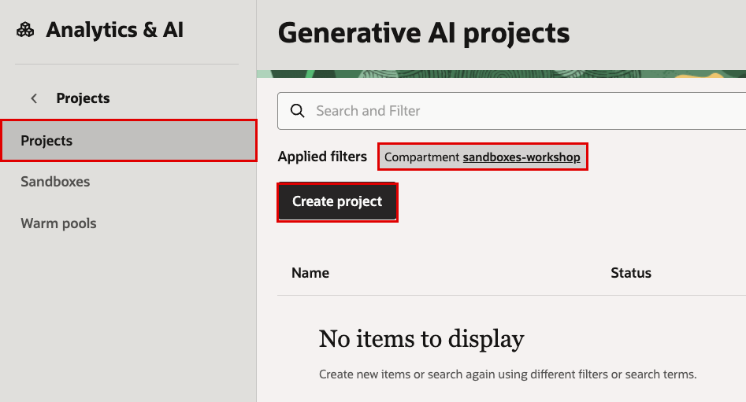

2. Complete the form:

    * **Name:** Enter `sandboxes-analysis`.
    * **Compartment:** Confirm that your workshop compartment is selected.

    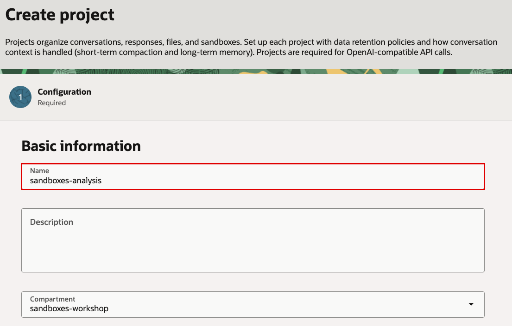

    * **Short-term memory compaction:** Enable short-term memory compaction.
    * **Compaction model:** Select `openai.gpt-oss-120b`.

        Compaction summarizes earlier conversation context as it grows, reducing the context sent to the model.

    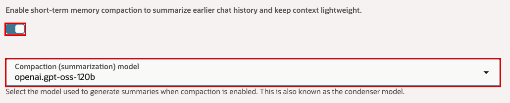

    * **Sandboxes:** Enable Sandboxes.
    * **Networking mode:** Use **Managed** networking.

        With **Managed**, OCI provides the networking and you control outbound connections through the **Network policy mode** setting. The alternative, **Custom** (Bring Your Own Network), routes outbound traffic through a subnet in your virtual cloud network (VCN). Your VCN routes and security rules control that traffic.

    * **Network policy mode:** Set to `DENY_ALL`.

        `DENY_ALL` blocks outbound connections from sandbox code, including requests to OCI services. In Lab 2, you will observe this restriction before allowing the Object Storage endpoint. The alternatives are `ALLOW`, which permits only specified domains and ports, and `ALLOW_ALL`, which allows outbound access to any URL.

    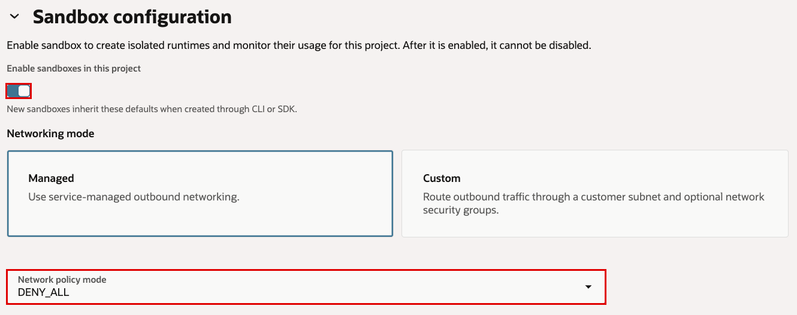

    * **Warm pool:** Click the **X** beside **Warm pool 1** to remove the default warm pool.

        Sandboxes will be created on demand. A warm pool instead keeps a chosen number of idle sandboxes ready to reduce startup delays. To configure a pool, choose **Managed** for the built-in Python runtime or **Custom** for your own container image. Select a compute shape (**Small**, **Medium** or **Large**) and the number of idle sandboxes to keep ready.

    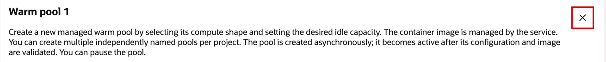

    Click **Create**.

    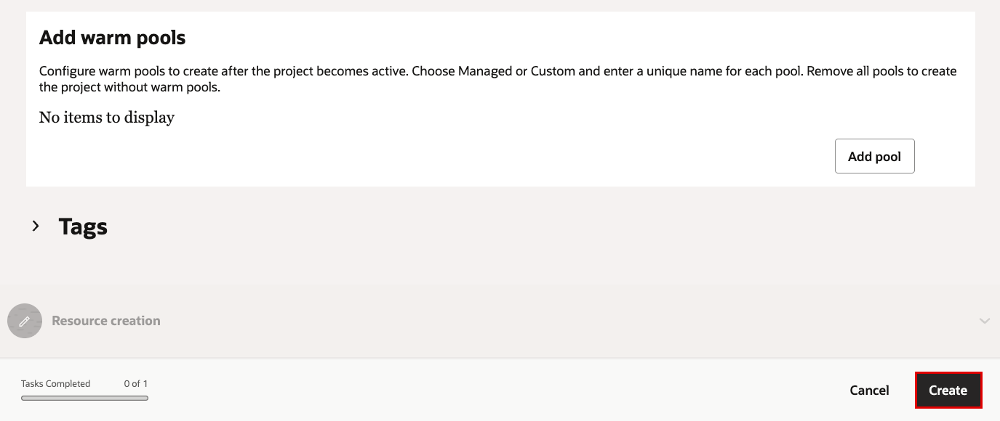

    Wait until the project's status changes to **Active**, indicating that it is ready to use.

    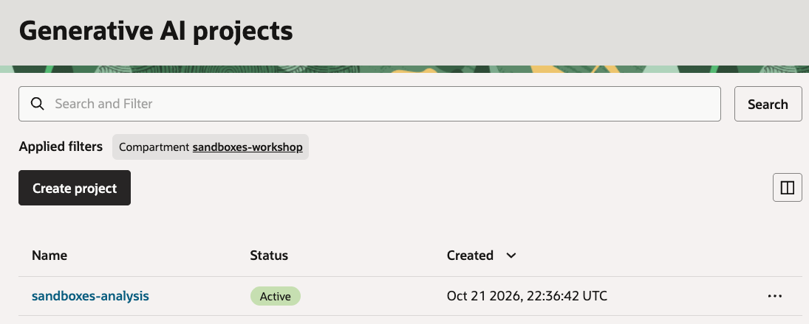

3. In Cloud Shell, run the setup script to check the project. If you used a different project name, replace `"sandboxes-analysis"` with that name:

    ```bash
    <copy>
    bash ~/sandboxes-workshop/setup.sh --check-project "sandboxes-analysis"
    </copy>
    ```

    The setup script uses the region and compartment saved in Task 3. It checks the project settings and saves the project OCID in `config.json` for the exercises.

    Confirm that each check shows **✓**:

    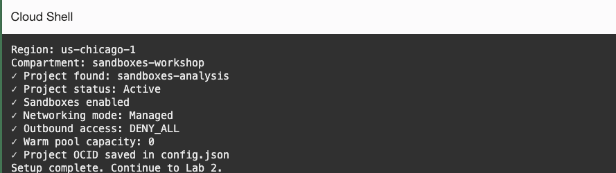

    If a check shows **✗**, follow the instruction beneath it and rerun the setup script with `--check-project`. Continue to Lab 2 when the output shows **Setup complete**.

## Learn More

* [Using Cloud Shell: file uploads and Python runtimes](https://docs.oracle.com/en-us/iaas/Content/API/Concepts/devcloudshellgettingstarted.htm)
* [Creating an IAM group](https://docs.oracle.com/en-us/iaas/Content/Identity/groups/create-groups.htm)
* [Creating an IAM policy](https://docs.oracle.com/en-us/iaas/Content/Identity/policymgmt/managingpolicies_topic-To_create_a_policy.htm)
* [API-level permissions for projects](https://docs.oracle.com/en-us/iaas/Content/generative-ai/project-permissions.htm)
* [Creating a project and configuring memory](https://docs.oracle.com/en-us/iaas/Content/generative-ai/create-project.htm)
* [Models and regions for short-term memory compaction](https://docs.oracle.com/en-us/iaas/Content/generative-ai/agentic-regions.htm)
* [IAM Policies for OCI Generative AI](https://docs.oracle.com/en-us/iaas/Content/generative-ai/iam-policies.htm)
* [Cloud Shell IAM requirements](https://docs.oracle.com/en-us/iaas/Content/API/Concepts/cloudshellintro.htm)
* [Cloud Shell networking and Public Network permissions](https://docs.oracle.com/en-us/iaas/Content/API/Concepts/cloudshellintro_topic-Cloud_Shell_Networking.htm)
* [OpenAI gpt-oss-120b model documentation](https://docs.oracle.com/en-us/iaas/Content/generative-ai/openai-gpt-oss-120b.htm)
* [OCI Responses API](https://docs.oracle.com/en-us/iaas/Content/generative-ai/responses-api.htm)
* [Generative AI Models by Region](https://docs.oracle.com/en-us/iaas/Content/generative-ai/model-endpoint-regions.htm)
* [Subscribing to an Infrastructure Region](https://docs.oracle.com/en-us/iaas/Content/Identity/regions/To_subscribe_to_an_infrastructure_region.htm)
* [Creating a Compartment](https://docs.oracle.com/en-us/iaas/Content/Identity/compartments/To_create_a_compartment.htm)

## Acknowledgements

* **Author** - Yanir Shahak
* **Last Updated By/Date** - Yanir Shahak, October 2026
